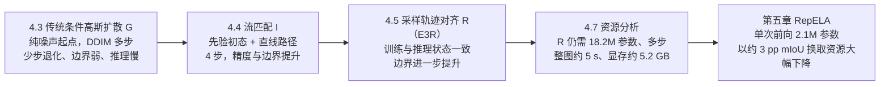

# 第四章最终可执行计划：基于条件扩散模型的二维材料层数分割

定稿于 2026-11-08。项目路径为 `/root/autodl-tmp/ConditionalDiffusionSeg`（AutoDL，RTX 3090 24 GB，conda 环境 `diffusion`）。

> [!NOTE]
> 本文件只是计划，**没有修改任何代码，也没有启动任何训练**。它按交接文档的粒度编写，可以直接在新会话中按步骤执行（见第 13 节）。

已确认的决定：

| 事项 | 决定 |
|---|---|
| 第四章标题 | 基于条件扩散模型的二维材料层数分割 |
| 主方法 | 保留 E3R（R） |
| 传统高斯扩散对照 | G-onehot 与 G-ordinal **都做**，按 R/I 协议重训 |
| I 的测试集评估 | **做**（4 步，预登记） |
| 状态差诊断 | **做**（G、I、R 三类） |

---

## 1. 递进逻辑



| 递进 | 要证明的上一步劣势 | 证据来源（实验编号） |
|---|---|---|
| G → I | 依赖多步；步数少时精度明显下降；边界弱；推理慢；存在训练与推理状态差 | S1、S6、S2、S4、S9 |
| I → R | 标签插值训练与自身轨迹推理不一致 | 已有 R/I/N/F 结果 + S9 |
| R → 第五章 | 参数、计算、显存、推理时延、训练耗时都很高 | S4、S5 + 已有 t5_cost |

---

## 2. 实验总表

| 编号 | 内容 | 输入 | 主要输出 | GPU 时间 |
|---|---|---|---|---:|
| S0 | 代码改动 + 工程检查 + git 提交 | — | 提交号、`engineering_check.json` | 0.5 h |
| S1 | G-onehot 训练（R/I 协议） | `configs/ch4_g_onehot.json` | `g_onehot/{best,last}.pt`、`history.json` | 3.0 h |
| S6 | G-ordinal 训练（R/I 协议） | `configs/ch4_g_ordinal.json` | `g_ordinal/...` | 3.0 h |
| S2 | G 两组 val25 步数扫描：DDIM 1/2/4/10/20/50 | S1、S6 的 best | `eval/steps_val_*.json` | 1.6 h |
| S7 | I 的提前返回曲线：1/2/4 步，val25 | I 的 best | `eval/steps_val_I.json` | 0.3 h |
| S8 | G 两组采样 seed 3408 复核 val25（DDIM20） | S1、S6 的 best | `eval/seed3408_*.json` | 0.3 h |
| S3 | test27 预登记评估：G-onehot / G-ordinal（DDIM20、DDIM4），I（4 步） | 各 best | `eval/test27_*.json` | 0.6 h |
| S9 | 状态差诊断：G 两组、I、R | 各 best | `diagnostics/*.json` | 1.0 h |
| S4 | 同会话统一推理测速 | 各权重 | `benchmark/inference.json` | 1.5 h |
| S5 | 训练资源测量 | 各训练代码 | `benchmark/training.json` | 1.0 h |
| **合计** | | | | **约 12.8 h** |

所有新产物统一放在 `outputs/ch4_progression_20261108/`（目录结构见第 9 节）。11-03 的旧结果 `outputs/diffusion_seg_20261103/` 只读保留，作为开发记录，不进正文。

---

## 3. S0：代码改动规格（只改 G 路径，默认关闭）

### 3.1 改动清单

| 文件 | 改动 | 新配置键（默认值） |
|---|---|---|
| `src/conditional_diffusion/diffusion_seg_experiment.py` · `SegmentationDataset.__getitem__` | 光度增强后加 vignette，公式与 `work/glpflow_core.py:photometric()` 第 103–112 行完全一致 | `photometric_vignette`（0.0） |
| 同上 | 翻转模式：`"both"` 为现有的双轴各 0.5；`"horizontal"` 为与 GLP 一致的仅水平翻转 p=0.5（`rgb[:, ::-1]`） | `flip_mode`（`"both"`） |
| 同上 · `train()` | 加入 EMA：复制 `glpflow_core.PowerEMA`（第 615–634 行），每次 `optimizer.step()` 后执行 `ema.update(model)`；验证和保存 best 时使用 `ema.shadow`；checkpoint 保存和恢复 EMA 状态；`metadata` 中 `ema` 字段如实记录 | `ema_sigma_rel`（`null` 表示关闭） |
| 同上 · `validate_config()` | 校验新键：vignette 在 [0, 0.5]；flip_mode 只能取上述两值；sigma_rel 为 null 或在 (0, 1) | — |
| 同上 · `evaluate()` / `predict_image()` | 支持覆盖 `sampling_steps` 和 `sampling_seed`，供步数扫描与 seed 复核使用（不改默认行为） | 函数参数 |
| 新增 `scripts/ch4_progression.py` | 子命令：`train`、`evaluate --split {val,test} --steps K --seed S`、`diagnose`、`bench-train`；只是封装现有函数，不重复实现 | — |
| 新增 `tests/test_ch4_options.py` | 单元测试：默认配置下数据增强逐字节不变；vignette 公式与 GLP 一致；EMA 的 gamma 与 GLP 一致 | — |

> [!IMPORTANT]
> 所有新键默认关闭，必须保证 11-03 的旧配置得到**逐字节相同**的裁块与权重更新。G 的薄层裁块随机数消耗顺序与 GLP 不同（`generator.choice` 与 `g.integers`），分布相同但具体裁块不同，不要为此重写，在论文中如实说明即可。

### 3.2 工程检查（全部通过才能开训）

| 检查 | 通过标准 |
|---|---|
| 现有 68 项单元测试 + 新测试 | 全部通过 |
| 旧配置回归 | `diffusion_seg_onehot.json` 跑 3 个 batch，loss 与 11-03 的 `history.json` 第 1 轮前几步一致；或者裁块哈希一致 |
| smoke | 两份新配置 `scripts/diffusion_seg.py smoke` 通过 |
| 恢复一致性 | `max_batches=3`："连续 2 轮"与"1 轮 + 恢复 1 轮"的 model、EMA、Adam、scheduler、RNG 逐位一致 |
| 显存 | B8 训练 20 步，峰值 reserved < 22.5 GiB（预计约 17 GiB） |
| 参数量 | onehot 18,192,148，ordinal 18,191,860（应与 11-03 metadata 一致） |
| 提交 | `git commit`，提交号写入 `outputs/ch4_progression_20261108/plan.json` 的 `expected_commit` |

---

## 4. S1、S6：训练配置

两份配置**只有** `representation`、`variant`、`status` 三项不同。以 G-onehot 为例：

```json
{
  "schema_version": 1, "method": "diffusion", "representation": "onehot", "variant": "ch4_g_onehot",
  "class_order": [0, 1, 2, 3],
  "manifest": "/root/autodl-tmp/ConditionalDiffusionSeg/data_manifests/source_dataset.json",
  "device": "cuda", "seed": 42, "cpu_threads": 4,
  "epochs": 100, "batch_size": 8, "workers": 8,
  "crop_size": 512, "stride": 384, "crops_per_image": 2, "thin_crop_fraction": 0.5,
  "photometric_gain": 0.1, "photometric_gamma": 0.1, "photometric_vignette": 0.15, "flip_mode": "horizontal",
  "lr": 0.00028, "min_lr": 1e-06, "warmup_epochs": 5, "weight_decay": 0.0001, "grad_clip": 1.0,
  "ema_sigma_rel": 0.1,
  "timesteps": 1000, "sampling_steps": 20, "sampling_seed": 3407, "window_batch_size": 16,
  "val_every": 10, "boundary_tolerance": 2,
  "ce_weight": 0.5, "dice_weight": 0.5, "reconstruction_weight": 1.0, "prior_loss_weight": 0.5,
  "max_run_gib": 1.0, "min_free_gib": 8.0,
  "model": {"widths": [32, 64, 128, 192], "token_dim": 256, "heads": 4, "na_kernel": 7},
  "status": "ch4 progression control; matched to controlled R/I protocol (B8, 100 ep, 3000 updates, EMA)",
  "data_scope": "train/val for training and selection; test27 only via pre-registered S3"
}
```

G-ordinal 将 `representation` 改为 `"ordinal"`，`variant` 改为 `"ch4_g_ordinal"`。

与 R/I 的对齐情况：

| 项目 | 是否一致 |
|---|---|
| batch、轮数、3000 次更新、24,000 次裁块曝光 | 一致 |
| 学习率、warmup、cosine 调度（按轮）、最小学习率、权重衰减、梯度裁剪 | 一致 |
| EMA 及用 EMA 权重验证、每 10 轮验证、按 val 四类 mIoU 选模 | 一致 |
| 增强方式（gain、gamma、vignette、旋转、水平翻转）、裁块与薄层比例 | 一致 |
| 训练 seed 42、采样 seed 3407、FP32、TF32 关闭 | 一致 |
| 初态、前向过程、采样器、步数、状态 MSE、自条件 | **方法定义差异**，论文中列表说明 |

启动方式：参照 `scripts/run_diffusion_seg.sh`，用串行队列依次跑 onehot → ordinal，设置 `PYTORCH_CUDA_ALLOC_CONF=expandable_segments:True`，用 nohup 后台运行，并写 `status.json`。每组预计训练约 1.6 h，加 10 次验证约 1.4 h。

---

## 5. 评估清单（S2、S3、S7、S8）

### 5.1 验证集（val25，可以多次评估）

| 编号 | 对象 | 设置 |
|---|---|---|
| S2 | G-onehot best、G-ordinal best | DDIM 1、2、4、10、20、50，eta=0，seed 3407 |
| S7 | I best（`outputs/P1/glpflow/seed_42/chapter_controlled_20261031_i/checkpoints/best.pt`） | 在第 1、2、4 步提前返回，沿用原 4 步时间网格（与 R 的 t4_steps 做法一致，参考 `work/chapter_controlled_20261031/analysis.py`） |
| S8 | G 两组 best | DDIM20，seed 3408 |

每次评估都保存四类 mIoU、各类 IoU、薄层 IoU、前景 BF@1/2/4px、单层与少层双向混淆、逐图混淆矩阵与边界计数、整图耗时。

### 5.2 测试集（test27，预登记，每个设置只评一次）

| 对象 | 设置 | 用途 |
|---|---|---|
| G-onehot best | DDIM20（主）、DDIM4（与 R 调用次数相同） | 传统扩散的测试集结果 |
| G-ordinal best | DDIM20、DDIM4 | 编码变体的测试集结果 |
| I best | 4 步，seed 3407 | 流匹配的测试集结果 |
| R | 已有（93.43 / 72.92），**不重评** | — |

> [!CAUTION]
> 测试集评估开始前，把上表写入 `plan.json` 的 `test_registration` 并计算哈希。之后不新增设置、不替换检查点、不根据测试结果挑选步数。I 的测试评价只作为递进证据，不替换 R 的主方法地位。

测试集推理参考 `work/test_glpflow_20261022.py`（I、R）和 `scripts/diffusion_seg.py evaluate`（G）。评价代码必须是第四章主表使用的同一实现（BF 采用 2px Chebyshev 容差、3×3 腐蚀、边缘复制）。

### 5.3 统计

- 配对 bootstrap：10,000 次图像重采样，seed 3407，比较 G-onehot−I、G-ordinal−G-onehot、I−R（val 与 test 分别计算）。
- 逐图剔除敏感性：沿用 4.5.2 的做法。
- 区间只描述固定权重下的图像抽样不确定性，不代表训练种子方差。

---

## 6. S9：状态差诊断

### 6.1 目的

量化"训练时见到的状态"与"推理时遇到的状态"不一致带来的端点精度损失：

- G：训练状态为真实掩码加噪 q(z_t | z_0)，推理状态来自自身 DDIM 轨迹。
- I：训练状态为标签插值，推理状态来自自身轨迹。
- R：训练与推理都用自身轨迹，作为差距约为零的参照。

### 6.2 方法

| 项目 | G-onehot / G-ordinal | I / R |
|---|---|---|
| 时间点 | DDIM20 网格中的 t ∈ {999, 749, 499, 249, 99, 0}（就近取网格点） | t ∈ {0, 0.25, 0.5, 0.75} |
| "训练型"状态 | z_t = √ᾱ_t·e(y) + √(1−ᾱ_t)·ε，ε 用固定 seed | x_t = (1−t)·x₀ + t·(2Y−1)，x₀ 用同一初态噪声 |
| "推理型"状态 | 从 z_T 出发，按 DDIM20 跑到 t 时的状态 | 自身 Euler 轨迹在 t 时的状态 |
| 测量 | 在同一 t、同一网络下，两种状态各自的端点预测 argmax 的 mIoU、薄层 IoU、BF | 同左 |
| 指标 | 差距 Δ_t = 训练型 − 推理型（单位 pp）；另报推理轨迹上逐步端点精度的变化曲线 | 同左 |
| 数据 | val25 全部 25 张图，原尺寸滑窗与融合方式与正式评估相同 | 同左 |

### 6.3 实现与预期

- **实现**：I/R 部分直接复用 `work/diagnose_glpflow_20261022.py`。该脚本已为 E3 计算过 t=0.25 时 oracle 与 self 相差 12.3 pp，需先确认它支持 I 和 R 的检查点。G 部分在 `scripts/ch4_progression.py diagnose` 中新写：两种状态共用同一个 `MaskStateCodec` 与 `GaussianMaskDiffusion`，只改变网络的状态输入。
- **预期写法**：如果 G 和 I 的 Δ_t 明显大于 0、R 接近 0，就支撑"状态不一致 → 采样对齐"的机制链。如果 G 的 Δ_t 很小，就如实写为"G 的主要劣势是步数与边界，而不是状态差"。

---

## 7. S4：统一推理测速

基于 `work/rebench_ch4_20261024.py` / `benchmark_ch4_20261024.py` 扩展，**所有对象在同一会话、无其他 GPU 进程时完成**。

| 对象 | 设置 |
|---|---|
| G-onehot | DDIM 4、20、50 |
| G-ordinal | DDIM 20 |
| I | 4 步 |
| R | 1、2、4 步（提前返回） |
| E1 | 1 步 |
| SegFormer-B1 | — |
| RepELA | 部署形态 |
| DDP、CCDM | 重测，保证同批次 |

| 指标 | 协议 |
|---|---|
| 参数量 | 整个推理系统，包含全局分支和先验头 |
| 单窗 GMACs | 与第四章相同的计数规则：图像编码只计一次，状态分支乘以步数 K |
| 单窗时延 | 512×512，batch 1，预热 20 次，计时 100 次，CUDA 同步，报中位数和 P95 |
| 整图时间 | 2560×1922，35 窗，window batch 8，固定 5 张 val 图 × 3 次，报中位数；指标计算不计入 |
| 峰值显存 | 整图预测期间 `max_memory_allocated` 和 `max_memory_reserved` |
| 环境记录 | GPU 型号、驱动、CUDA、PyTorch 版本、精度 FP32、TF32 关闭 |

> [!WARNING]
> 跨章计算加速比时只能使用本批数据，不能与 10-24 那一批的 5.110 s 等旧数值混合计算。

---

## 8. S5：训练资源测量

| 对象 | 训练代码 | 正式 batch |
|---|---|---|
| G-onehot、G-ordinal | `diffusion_seg_experiment.train_step` | 8 |
| I、R | `work/chapter_controlled_20261031/core.py`（R 包含无梯度的轨迹前缀） | 8 |
| E1 | `work/glpflow_core.py` | 8 |
| SegFormer-B1 | `work/baselines_20261022` | 8 |
| RepELA | 第四章扩展批次中复制的 PhysicalNet 代码 | 按其协议 |

- **测量**：每个对象预热 10 次更新，再计时 50 次（数据加载与正式设置一致），记录秒/更新、裁块/秒，以及训练峰值 allocated 和 reserved 显存。
- **换算**：3000 次更新所需 GPU 时间，另外单列验证开销（每次验证耗时 × 10）。
- **核对**：与实际墙钟时间比较。E3R 为 08:53–11:13（含验证）；RepELA 每轮约 14–21 s；G 以 S1、S6 的 `history.json` 中的 `train_seconds` 为准；I/R/N/F 取 10-31 批次日志。

---

## 9. 输出目录

```text
outputs/ch4_progression_20261108/
├── plan.json                 冻结的配置哈希、expected_commit、test_registration
├── status.json               队列状态
├── engineering_check.json    S0 检查结果
├── configs/                  ch4_g_onehot.json、ch4_g_ordinal.json 的冻结副本
├── g_onehot/  g_ordinal/     best.pt、last.pt、history.json、metadata.json、provenance.json
├── eval/                     steps_val_*.json、seed3408_*.json、test27_*.json、bootstrap.json
├── diagnostics/              state_gap_{g_onehot,g_ordinal,I,R}.json
├── benchmark/                inference.json、training.json、环境信息
├── logs/
├── tables/                   论文用 CSV（见第 11 节）
└── figures/
```

存储：两组权重加评估约 2 GiB，当前数据盘剩余 18 GB，满足至少保留 8 GiB 的要求。

---

## 10. 执行队列与时间表

| 时段 | 顺序 | 任务 | GPU 时间 |
|---|---|---|---:|
| 第 1 天 白天 | 1 | S0 代码改动、检查、提交 | 0.5 h |
| 第 1 天 夜间（自动串行队列） | 2 | S1 G-onehot 训练 | 3.0 h |
| | 3 | S6 G-ordinal 训练 | 3.0 h |
| | 4 | S2 + S8 + S7（只用 val） | 2.2 h |
| | 5 | 写入 test_registration 后，执行 S3 test27 | 0.6 h |
| 第 2 天 上午 | 6 | S9 状态差诊断 | 1.0 h |
| | 7 | S4 统一推理测速（独占 GPU） | 1.5 h |
| | 8 | S5 训练资源测量 | 1.0 h |
| 第 2—4 天 | 9 | 统计分析、表格、作图、论文修订、重建 docx/pdf | 0 |

GPU 合计约 12.8 h。队列中任一步失败就停止，并写入 `status.json`，不自动跳过。OOM 时只允许加 `expandable_segments` 后续训，不允许改 batch。

---

## 11. 论文表格与图

| 编号（暂定） | 内容 | 数据来源 |
|---|---|---|
| 表 4-x 方法对照 | G / I / R 在初态、路径、训练状态、采样器、步数、损失上的区别 | 方法定义 |
| 表 4-x 传统扩散结果 | G-onehot、G-ordinal 在 val25 上的结果（DDIM20），加 seed 3408 | S1、S6、S8 |
| 图 4-x 步数—精度曲线 | 横轴为网络调用次数（对数），纵轴为 mIoU 和 BF；G 取 1–50 步，I 和 R 取 1/2/4 步 | S2、S7、t4_steps |
| 图 4-x 状态差诊断 | 各 t 下的 Δ_t 柱状图，G、I、R 并列 | S9 |
| 表 4-x 递进主表（val25） | G-onehot → G-ordinal → I → R（加 N、F、E1 作为参照） | S1、S6、已有 |
| 表 4-x 测试集主表 | 外部基线（含 DDP、CCDM）+ E0、E1 + G 两组 + I + R | S3、t4_main |
| 表 4-x 推理资源阶梯 | 参数、GMACs、单窗时延、整图时间、显存 | S4 |
| 表 4-x 训练资源 | 秒/更新、3000 次更新 GPU 时间、验证开销、训练峰值显存 | S5 |
| 图 4-x 质量—时间散点 | 横轴为整图时间（对数），纵轴为 test mIoU，点的大小表示参数量；G、I、R、E1、外部基线、RepELA | S3、S4 |
| 表 5-x 跨章表（更新） | 加入 G-DDIM20 行，并增加训练 GPU 时间、训练显存两列 | S4、S5 |

图件沿用项目现有的中文字体与完整边框规范，并由脚本生成，保证可重建。

---

## 12. 论文修订清单

在新目录 `docs/thesis/chapter4_diffusion_revision_20261108/` 中修改，从 `chapters35_integration_20261101/masters_thesis_20261101/` 复制，**不覆盖**原整合稿。

| 位置 | 修改 |
|---|---|
| 标题 | `04_flow.md` 第 1 行改为"第四章 基于条件扩散模型的二维材料层数分割"；同步修改 `00_abstract.md`、`01_introduction.md` 第 57 行附近、`硕士论文_完整初稿.md`、`scripts/build_thesis.py` |
| 第二章 | 新增"条件扩散模型"小节：DDPM 前向与反向过程、DDIM、流匹配与直线路径、扩散分割的条件方式；原"条件流建模"并入 |
| 4.1 | 改为递进叙事，加入第 1 节的路线图 |
| 4.2 | 共享的 GLP 去噪网络（原 4.2.1、4.2.3），说明三类方法共用骨干、参数相差 < 0.03% |
| **4.3（新）** | 传统条件高斯掩码扩散：公式、S1/S6/S8 结果、S2 步数曲线、S9 中 G 的状态差；小结其劣势 |
| **4.4（新）** | 流匹配少步生成：先验初态、直线路径、Euler 更新（原 4.2.2、4.3.2）；I 的结果与 S7；与 G 对比 |
| 4.5 | 采样轨迹对齐（原 4.3.1、4.3.3、4.5、4.6）：R/I/N/F 与 S9 |
| 4.6 | 测试集主表（S3 + t4_main） |
| 4.7 | 资源分析：S4、S5、质量—时间散点；保留原有的 R 提前返回取舍 |
| 4.8 | 递进小结，并过渡到第五章 |
| 第五章 5.1 / 5.5 | 承接 4.7；更新跨章表 |
| 第六章 | 按"传统扩散 → 流匹配 → 对齐 → 轻量化"重写总结 |
| 构建脚本 | 修复 `revise_chapter4_assets.py` 的 ROOT 路径；`chapter5_plots.py` 的输出目录改为参数传入 |
| 小论文精度 | 跨章比较只用统一协议（RepELA 90.31%）；84.64% 标明为历史 200 轮 seed 123 的单次结果 |
| README | 根 README 开头增加"当前状态索引"，删除过时的"E3R 正在训练"表述 |

---

## 13. 结果解读规则（训练前固定，写入 plan.json）

| 结果 | 4.3 → 4.4 的写法 |
|---|---|
| ① G-DDIM20 的 mIoU 和 BF 都低于 I，且 DDIM4 明显下降 | 传统扩散多步、慢、边界弱；流匹配用 4 步同时提升精度和边界 |
| ② G-DDIM20 精度接近 I，但 DDIM4 明显下降，或者 DDIM20 明显更慢 | 效率叙事：流匹配以约 1/5 的步数达到同等质量 |
| ③ G-DDIM4 仍接近 I | 递进依靠边界与对齐机制（I → R 和 S9），并如实写出"步数优势不明显" |
| ④ G 优于 I 或 R | 如实报告；把 R 定位为"少步、边界更好"的方案，资源递进不变 |
| G-ordinal 与 G-onehot 的差距 < 1 pp | 写为"改进掩码编码对传统扩散收益有限，瓶颈在采样路径与状态" |
| G-ordinal 与 G-onehot 的差距 ≥ 1 pp | 写为"有序编码有帮助，但不能解决多步与资源问题" |

所有比较以百分点表示，并附配对 bootstrap 区间；不使用"显著"一词。

## 14. 风险与应对

| 风险 | 应对 |
|---|---|
| 加入 EMA 后旧配置的结果改变 | 默认关闭 + 回归检查（3.2 节） |
| G 训练 OOM | B8 预计约 17 GiB；出问题只加 `expandable_segments` 后续训，不改 batch |
| 训练 / 推理时间超出估计 | 按 S1 第 1 轮的实际 `train_seconds` 重新估计；验证频率不改，保证与 R/I 一致 |
| 结果与预期叙事不符 | 按第 13 节预先写好的规则写作，不调参、不重选 |
| 测试集被多次使用 | test_registration 哈希 + 每个设置只评一次 |
| `diagnose_glpflow_20261022.py` 与 I/R 检查点不兼容 | 先用 1 张图做小测，必要时在新脚本中复用其函数 |
| 磁盘空间 | 每组 1 GiB 上限；开训前运行 `scripts/check_storage.py` |

## 15. 新会话交接（按此顺序执行）

1. 运行 `ssh autodl`，进入 `cd ~/autodl-tmp/ConditionalDiffusionSeg`，执行 `conda activate diffusion`；用 `git log -1` 确认当前提交为 `0e95adf`，`nvidia-smi` 确认 GPU 空闲。
2. 读本计划第 3 节，完成 S0 的代码改动与 3.2 节全部检查，然后提交。
3. 创建 `outputs/ch4_progression_20261108/`，写入 `plan.json`（含配置哈希、expected_commit、第 13 节的解读规则）。
4. 启动夜间串行队列：S1 → S6 → S2/S8/S7 → 写入 test_registration → S3。
5. 第 2 天依次执行 S9 → S4 → S5，生成第 11 节的表格和图。
6. 按第 12 节修订论文，重建 docx/pdf，检查图表编号与交叉引用。
